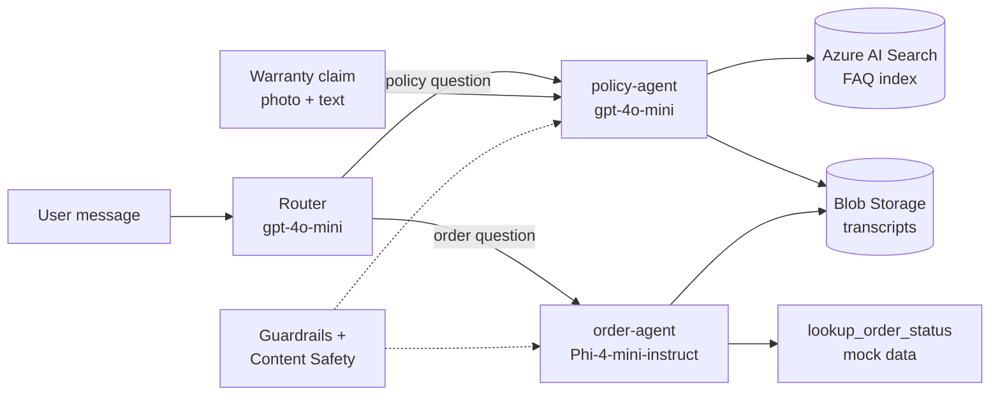

# Azure AI Foundry Agents: Three Hands-On Projects

Three Python projects that grow from a basic chatbot to a multi-agent solution on **Microsoft Foundry** (formerly Azure AI Foundry). They use a fictional shop, "Contoso Basics", and synthetic data only.

If you only have a few minutes, start with **Project 3**. It is the most complete and includes the ideas from the first two.

## Projects

| # | Project | What it shows | Azure services | Folder |
|---|---|---|---|---|
| 1 | **Foundry Chat Console** | Console chatbot on a Phi-4-mini-instruct deployment; saves each conversation to Blob Storage | Foundry, Blob Storage | `01-foundry-chat-console` |
| 2 | **Contoso Support Agent** | A Foundry agent with RAG over Azure AI Search plus a custom function tool for order lookup | Foundry Agent Service, AI Search (Free), Blob Storage | `02-rag-support-agent` |
| 3 | **Contoso Multi-Agent Support** | Router with two specialist agents, an MCP tool, photo-based warranty claims, and content safety | All of the above, plus Content Safety, Guardrails, Microsoft Learn MCP | `03-multi-agent-support` |

## How Project 3 works



- **RAG:** the policy agent answers only from the indexed returns, shipping and warranty documents.
- **Function calling:** the order agent calls a Python function to look up order status.
- **MCP:** `mcp_docs_agent.py` is a separate demo that calls Microsoft's public Learn MCP server.
- **Multimodal:** `warranty_claim.py` sends a product photo and a description to judge whether damage looks like a covered defect.
- **Responsible AI:** portal Guardrails on the agents, plus `safety_check.py` for programmatic text checks (hate, self-harm, sexual, violence).

## Repository structure

```
azure-foundry-ai-agents/
├── 01-foundry-chat-console/
│   ├── chatbot.py
│   ├── requirements.txt
│   └── .env.example
├── 02-rag-support-agent/
│   ├── create_agent.py
│   ├── support_chat.py
│   ├── knowledge-docs/          # returns, shipping and warranty sample texts
│   ├── requirements.txt
│   └── .env.example
├── 03-multi-agent-support/
│   ├── create_specialist_agents.py
│   ├── orchestrator.py
│   ├── mcp_docs_agent.py
│   ├── warranty_claim.py
│   ├── safety_check.py
│   ├── requirements.txt
│   └── .env.example
└── README.md
```

## Quick start

**You need:** an Azure subscription (a free trial works), Python 3.10+, and the Azure CLI. The code calls your own Foundry project, so the Azure resources must exist first: a Foundry resource and project, a Storage account, and an Azure AI Search service (Free tier) with an index built from `knowledge-docs`.

```powershell
cd 03-multi-agent-support
python -m venv venv
venv\Scripts\activate              # macOS/Linux: source venv/bin/activate
pip install -r requirements.txt
copy .env.example .env             # then fill in your own values
az login                           # needed by the agent SDK

python create_specialist_agents.py   # run once to register the agents
python orchestrator.py               # try: "What's your returns policy?" and "Status of ORD-1042?"
```

Other scripts: `python mcp_docs_agent.py`, `python warranty_claim.py`, `python safety_check.py`. For Project 2 run `create_agent.py` once, then `support_chat.py`. For Project 1 run `chatbot.py`.

## Configuration

Each folder has a `.env.example` listing the variable names it needs. Copy it to `.env` and add your own values. Real values are never committed.

| Project | Variables |
|---|---|
| 1 | `FOUNDRY_ENDPOINT`, `FOUNDRY_DEPLOYMENT`, `FOUNDRY_API_KEY`, `STORAGE_CONNECTION_STRING`, `STORAGE_CONTAINER` |
| 2 | `FOUNDRY_PROJECT_ENDPOINT`, `FOUNDRY_AGENT_MODEL`, `FOUNDRY_AGENT_NAME`, `SEARCH_CONNECTION_NAME`, `SEARCH_INDEX_NAME`, `STORAGE_CONNECTION_STRING`, `STORAGE_CONTAINER` |
| 3 | `FOUNDRY_PROJECT_ENDPOINT`, `FOUNDRY_BASE_ENDPOINT`, `FOUNDRY_API_KEY`, `PHI_DEPLOYMENT`, `GPT_DEPLOYMENT`, `STORAGE_CONNECTION_STRING`, `CHAT_CONTAINER`, `SEARCH_CONNECTION_NAME`, `SEARCH_INDEX_NAME` |

## Lessons learned while building

These were observed during testing and may change as the services evolve.

- **Model choice matters per tool.** Phi-4-mini-instruct handled function calling well, but the hosted Azure AI Search tool returned a server error with it. The RAG agent uses gpt-4o-mini; the order agent uses Phi-4-mini-instruct.
- **Rate limits.** The default low tokens-per-minute setting caused 429 errors on RAG requests; a 10K TPM deployment avoided them.
- **Agent calls** need the `agent_reference` key inside `extra_body`; the older key name is rejected.
- **Two kinds of authentication.** Agent management uses Azure AD (`az login`), while direct model calls in Project 1 use an API key.
- **Orchestration.** The classic Connected Agents tool is retired, so Project 3 uses a simple code-first router. Foundry's Workflow builder and the A2A protocol are natural next steps.
- **MCP in Python** goes through the Microsoft Agent Framework package, which is a different SDK from the rest of the project.

## Security and cost

- No keys, connection strings or personal data are in this repository; `.env` is git-ignored. Some scripts use an API key or connection string for simplicity; for production, prefer managed identity and Key Vault.
- Order data is mock data. Use your own non-personal photos if you test the warranty script.
- Everything is designed to fit free trial credits and the Free search tier. Check Cost Management, and when finished, delete the resource group to stop all charges.

## Next steps

Native A2A between agents, the portal Workflow builder, a custom MCP server wrapping the order lookup, and an evaluation set for retrieval and routing quality.

## Notes

Hands-on practice projects built in 2026 while working through Microsoft's AI-103 course topics. Uploaded to GitHub on 10 October 2026.
